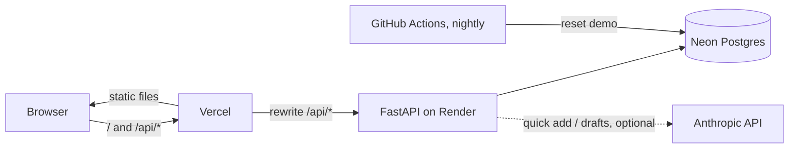

# Ember

A job search tracker for one person running their own search. Drag applications across a board, paste a job post and get the fields pulled out for you, see which jobs have gone quiet, and find out what's actually getting replies.

**Live demo:** hit "View live demo" on the landing page. It's a shared account with a couple months of fake-but-realistic data, and it resets every night.

## What it does

- **Pipeline**: board with seven columns (saved → applied → OA → interview → offer / rejected / ghosted) you drag cards between, plus a table with search, filters, and sorting that stays smooth at 10k+ rows.
- **Quick Add**: paste a job post and get company, role, location, seniority, and requirements back. Claude does it if there's an API key, a regex extractor does it if there isn't, and you always review before saving.
- **Ghost Radar**: open applications with no movement in N days (14 by default). One click drafts a follow-up email. It only flags stuff and never moves anything to Ghosted for you.
- **Weekly Sprint**: progress ring toward a weekly goal, plus a streak. Weeks run Monday to Sunday in *your* timezone.
- **Market Pulse**: response rate by source, by role type, and by the day you applied, plus median time until you hear back.
- **CSV import/export**: bring in a spreadsheet, take your data out. Dedupes on company + role + link.

## Stack

| | |
|---|---|
| Frontend | React 19, TypeScript, Vite, Tailwind v4, TanStack Query + Virtual, dnd-kit, Recharts, Framer Motion |
| Backend | FastAPI, SQLAlchemy 2.0, Alembic, Pydantic v2, Postgres 16 |
| Auth | email + password (argon2id), opaque session token in an HttpOnly cookie, only the SHA-256 of it stored |
| LLM | Anthropic API (Claude Haiku by default), server-side only |
| Hosting | Vercel (frontend) + Render (API) + Neon (Postgres) + GitHub Actions (nightly demo reset), all free tier |

## How it fits together



The browser only ever talks to one origin. Vercel serves the React app and forwards `/api/*` to Render, so the session cookie is plain first-party `SameSite=Lax` with no cross-site cookie headaches and basically no CORS.

## Decisions worth explaining

- **Sessions, not JWTs.** The cookie holds a random token and the DB holds its hash. Logout actually deletes the session, and a DB leak doesn't hand out working cookies.
- **Every query is scoped by `user_id`.** There's a test that logs in as someone else and checks they get nothing.
- **Naive first, then fast, both kept.** Analytics, list, and import each have a `naive.py` (load everything into Python and loop) and an `optimized.py` (let Postgres do it). A test runs both on the same fake data and makes sure they agree. The benchmark compares them. Numbers are in [docs/BENCHMARKS.md](docs/BENCHMARKS.md): at 50k rows analytics goes from ~2.8s to ~62ms.
- **One place for metric definitions.** [`services/metrics.py`](backend/app/services/metrics.py) decides what a "response" is and how streaks work, and everything else imports it.
- **Timezones are real.** Each user stores an IANA zone, `applied_at` is their local calendar date, and there are tests for Sunday-night vs Monday-morning, both DST flips, and zones ahead of UTC.
- **The LLM is optional.** Quick Add goes cache → Claude → regex. A missing key, bad JSON, a timeout, or a refusal all just fall back. Results are cached by a hash of the paste so the same post only gets billed once.
- **Rate limiting knows about the proxies.** Behind Vercel + Render the socket IP is a load balancer, so the limiter reads `X-Forwarded-For` from the right by a configured number of trusted hops and ignores anything a client prepends. It's in-process, which is fine for one instance. Redis is the next step if it ever scales out.
- **Demo can't cost money or break anything permanent.** It's a shared account that resets nightly. Settings are locked, import and row counts are capped, and Quick Add / drafts only use the free paths.

## Run it locally

Needs Docker, Python 3.12+, and Node 22.

```bash
cp .env.example .env
make db                                  # postgres in docker on :5433
python3 -m venv .venv && .venv/bin/pip install -e "backend[dev]"
make migrate
make api                                 # http://localhost:8000/api/health

cd frontend && npm install && npm run dev   # http://localhost:5173
```

Want the demo button to work locally? `cd backend && ../.venv/bin/python -m scripts.reset_demo`.

Want to see the table with a lot of rows? Sign up, then `.venv/bin/python benchmarks/seed.py you@example.com 10000`.

Quick Add uses regex until you put `ANTHROPIC_API_KEY` in `.env`.

## Tests

```bash
make test                 # backend, needs the docker db up
make lint                 # ruff + oxlint + tsc
cd frontend && npm test   # vitest
```

CI runs all of it on every push.

## Benchmarks

```bash
make bench
```

Seeds 1k / 10k / 50k applications into throwaway users, times naive vs optimized (median + p95), and rewrites [docs/BENCHMARKS.md](docs/BENCHMARKS.md) with whatever your machine says, `EXPLAIN ANALYZE` included. Nothing in that file is hand-typed.

## Deploying

See [docs/DEPLOY.md](docs/DEPLOY.md). Short version: Neon for the database, Render blueprint for the API, Vercel for the frontend, then point `vercel.json` at your Render URL. Everything's on free tiers.

## Project layout

```text
backend/
  app/
    api/            thin route handlers
    services/       the actual logic (analytics/, importing/, listing/, extract/ ...)
    models/         SQLAlchemy tables
    schemas/        request/response shapes
    middleware/     rate limiting
  alembic/          migrations
  scripts/          reset_demo.py (nightly via github actions)
  tests/
frontend/src/
  pages/            one per screen
  components/       pipeline/, analytics/, ui/
  lib/              api client, hooks, date helpers
benchmarks/         seed + run scripts
docs/               BENCHMARKS.md, DEPLOY.md
```
